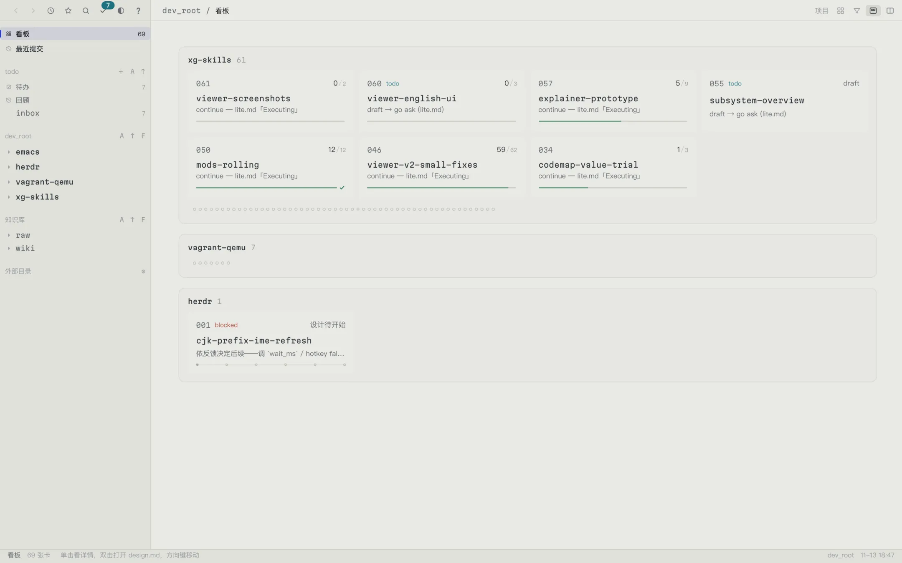

# xg-skills

Three [Claude Code](https://claude.com/claude-code) skill packages for grounding
substantive engineering work in durable, reusable knowledge. The first two are siblings:
the workflow *orchestrates* code work and links out to the knowledge base for
reusable module knowledge; the knowledge base never stores workflow state.

Each package is Markdown-driven — a `SKILL.md` contract plus on-demand
`references/` and a few dependency-free Python helpers. There is no build or
test pipeline; "running" a skill means Claude Code loading its `SKILL.md` and
following the procedure.

<picture>
  <source media="(prefers-color-scheme: dark)" srcset="xg-dev-workflow/docs/screenshots/board-dark.webp">
  
</picture>

The workflow's status viewer (`xg-dev-workflow/tools/viewer.py`); more screenshots in
[`xg-dev-workflow/README.md`](xg-dev-workflow/README.md#status-viewer).

## Packages

### [`xg-dev-workflow/`](xg-dev-workflow/)

A design-centric development workflow. Gated phases —
requirement → design → detail → implement → test — plus a close-out review
gate, where **one requirement maps to one directory of docs** (a "card").

Verbs: `new`, `requirement`, `design`, `detail`, `plan`, `test`,
`investigate`, `review`, `change`, `resume`, `check`, `retro`.

Decision phases advance one gate per invocation and stop for human approval;
once execution is authorized, implementation and testing flow autonomously.

### [`xg-knowledge-lite/`](xg-knowledge-lite/)

A cross-project code-knowledge base with two layers (after Karpathy's
"two-layer" idea): `raw/<project>/*.md` investigation write-ups — the source of
truth — are compiled into `wiki/<project>/<concept>.md` concept articles.

Actions: Write, Compile, Query, Orient, Lint.

### [`xg-codemap/`](xg-codemap/)

A shared intent map between a human and a coding agent (v0, value trial): the
agent draws what the software *is* — nodes anchored to real symbols, commits
and files, claims marked verified or inferred, nothing in scope omitted by
accident — and the human marks on the same map what it *should become*, each
wish with an acceptance predicate. Standalone by design: it knows nothing about
the other two packages and reads no shared configuration; they may call it, it
never calls them. Hand-drawn Markdown + Mermaid today; a checker, resolvers and
an interactive surface are later stages, gated on the trial.

### [`mods/`](mods/)

Claude Code mods that surface the skills in the session itself: `xg-hud` draws a
band above the prompt (the session's KB activity, its current workflow card, and
a todo queue kept in the workflow's todo files), and `xg-git-guard` checks Bash
git calls against the commit and push conventions. Mods depend on the skills'
scripts and files; the skills never depend on a mod.

## Layout

```
<skill>/
  SKILL.md       # YAML frontmatter (name + description) + the procedure
  README.md      # per-package overview
  references/    # steps / templates / format specs — loaded on demand
  tools/         # Python helpers (stdlib; optional PyYAML with a text fallback)
```

## Install

Make each package discoverable to Claude Code as a skill — e.g. symlink the
directories into your personal skills location:

```sh
ln -s "$PWD/xg-dev-workflow"   ~/.claude/skills/xg-dev-workflow
ln -s "$PWD/xg-knowledge-lite" ~/.claude/skills/xg-knowledge-lite
```

The mods load from directories named in `CLAUDE_CODE_PLUGIN_DIRS` (the `env` block of
`~/.claude/settings.json`), e.g.:

```sh
mkdir -p ~/.claude/mods
ln -s "$PWD/mods/xg-hud"       ~/.claude/mods/xg-hud
ln -s "$PWD/mods/xg-git-guard" ~/.claude/mods/xg-git-guard
# settings.json: "CLAUDE_CODE_PLUGIN_DIRS": "<home>/.claude/mods/xg-git-guard:<home>/.claude/mods/xg-hud"
```

Both skills share one config at `~/.config/xg-knowledge-wiki/config.yaml`
(knowledge-base root, workflow-docs root, and a project map); scripts never
auto-create it. All user data — notes, workflow docs, config — lives **outside**
this repo; the repo holds skill logic only.

## License

[MIT](LICENSE). Vendored third-party code (`marked`) retains its own license —
see [`xg-dev-workflow/tools/viewer/marked.LICENSE.md`](xg-dev-workflow/tools/viewer/marked.LICENSE.md).
